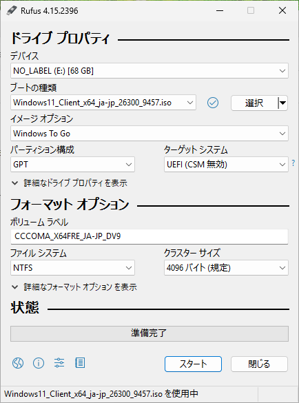
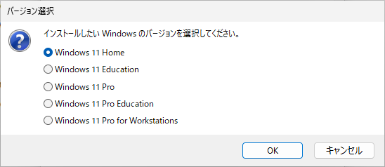
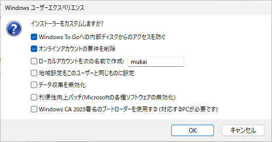
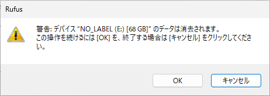
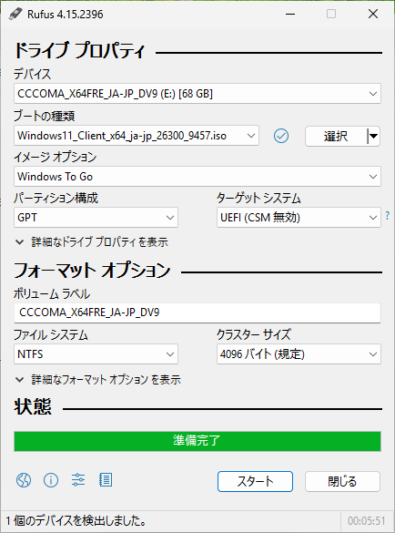

## Windows To Go（Rufus）

BIOSやIntel MEファームウェアの更新はWindowsから行うツールしか提供されていないことも多く、Linuxユーザー的には大問題。[Rufus](https://github.com/pbatard/rufus)には、かつてあったWindows To Go的な起動ディスクを作れる機能があるので、これで代用できないか。

```
$ sha256sum rufus-4.15.exe
84c8a437f8af89257524478489e5c85f1edf25f761d299e2bcde46ac0afbe106  rufus-4.15.exe
$ sha256sum Windows11_Client_x64_ja-jp_26300_9457.iso
923ec1a2ec46ccbe607fc81beaf9753bfbb6fc62220b7b8bffd56e66f6de3a0c  Windows11_Client_x64_ja-jp_26300_9457.iso
```

64GiBのraw領域を作成する

```
sudo qemu-img create -f raw -o preallocation=falloc /var/lib/libvirt/images/win2go.raw 64G
```

win2go-usb.xml

```
<disk type='file' device='disk'>
  <driver name='qemu' type='raw'/>
  <source file='/var/lib/libvirt/images/win2go.raw'/>
  <target dev='sdc' bus='usb' removable='on'/>
  <serial>WIN2GO64</serial>
</disk>
```

起動中にホットプラグ

```
virsh attach-device win11 /tmp/tmp.xOxHRLiBYH/win2go-usb.xml --live
```











安全な取り外しを行ってからデタッチ

```
virsh detach-device win11 /tmp/tmp.xOxHRLiBYH/win2go-usb.xml --live
```

```
sudo mv /var/lib/libvirt/images/win2go.raw .
sudo chown mukai win2go.raw

sha256sum win2go.raw
adef24d0de0ca39b6a659f96e15a6e646cd6d830b20347dbf814794bd02b3c6a  win2go.raw
```

ディスクを完全に取り外して起動する想定でも何箇所か書き込みが発生するので要注意 [report.md](report.md)
